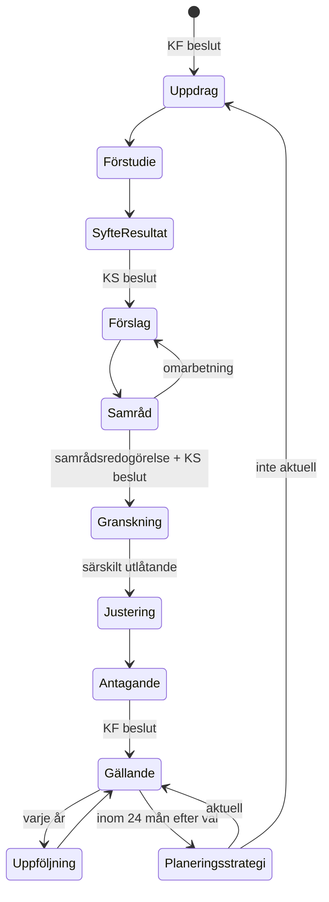

# 04: Capabilities and the planning process

This doc defines what the platform must *be able to do* (capabilities), using Luleå kommun's comprehensive planning (översiktlig planering) as the reference workflow. **Capabilities exist to meet the requirements in [00: Participation design framework](00-participation-design-framework.md)**; the "Serves" column links each one to them. Features and screens come later. Each one should map to a capability here.

Sources:
- [Luleå: Arbetsprocess för översiktlig planering](https://www.lulea.se/samhalle--utveckling/samhallsplanering/oversiktsplan/vad-ar-oversiktlig-planering/arbetsprocess.html) (page dated 2019)
- [Luleå: Översiktsplan](https://www.lulea.se/samhalle--utveckling/samhallsplanering/oversiktsplan.html)
- [Digital översiktsplan, op.lulea.se](https://op.lulea.se)
- Plan- och bygglagen (PBL) chapter 3. Paragraph-level details are not cited here; verify them against the current law text before relying on them.

## 1. The reference workflow

### Luleå's process (as published)

| # | Step | Decided by | Output |
|---|---|---|---|
| 1 | **Uppdrag** (commission): revise the plan or produce a new one | Kommunfullmäktige (KF) | Decision |
| 2 | **Förstudie** (pre-study): dialogues on problems, challenges and strengths | Officials | Pre-study material |
| 3 | **Syfte och resultat** (purpose and intended result) | Kommunstyrelsen (KS) | Decision |
| 4 | **Förslag** (proposal): drafted in dialogue with residents, businesses and organisations | Samhällsutvecklingskontoret | Draft plan |
| 5 | **Samråd** (consultation), 2–3 months | n/a | Comments, improved draft |
| 6 | **Granskning** (public review), 2–3 months: written, more formal comments | KS decides to start it | Granskningsyttranden (review statements) |
| 7 | **Justeringar** (adjustments) | n/a | Final proposal |
| 8 | **Antagande** (adoption) | KF | Adopted plan |

After adoption the plan is followed up **every year** and **evaluated every four years**. A **planeringsstrategi** (planning strategy) keeps it current.

### What PBL adds (not on Luleå's page)

- **Länsstyrelsen** (the County Administrative Board) has a statutory role in samråd. During granskning it issues a **granskningsyttrande** that must be published with the adopted plan.
- After samråd, the municipality writes a **samrådsredogörelse**: all comments received, plus how each was handled.
- After granskning, it writes a **särskilt utlåtande** (Luleå calls it *granskningsutlåtande*) covering comments that were not accommodated.
- Granskning lasts at least two months.
- Within 24 months of each ordinary election, KF adopts a **planeringsstrategi** that decides whether the plan is still current (*aktualitet*).
- **Remissinstanser** (bodies formally consulted), e.g. neighbouring municipalities, the region, Trafikverket and Försvarsmakten, take part alongside the public.

### Same shape, other plan types

Fördjupningar (FÖP, detailed comprehensive plans for an area) and tematiska tillägg (thematic additions) follow the same chapter 3 process. **Detaljplaner** (zoning plans, PBL chapter 5) use a similar samråd → granskning → antagande pattern, with a standard and an extended procedure. They are the plans citizens meet most often.

**Design consequence:** don't hard-code the ÖP process. Model a *process definition* (phases, gates, required outputs, roles, minimum durations) as versioned data. Then ÖP, FÖP, tillägg, planeringsstrategi and detaljplan are each just a definition.



## 2. Capability map

Each level 1 capability is a bounded area that can become a backend module and a `features/` folder in the frontend.

| # | Capability | What it must do | Lineage it produces | Serves |
|---|---|---|---|---|
| C1 | **Plan process management** | Run process instances from a definition: phases, gates, deadlines, roles, required outputs. Block a gate when an output is missing, e.g. no samrådsredogörelse means no granskning | Which phase a plan was in when something happened | GOV-1, GOV-2 |
| C2 | **Plan content** | Structured, versioned plan: chapters, **ställningstaganden** (policy statements), land-use areas on the map, fördjupningar and tillägg. Versions per phase (samrådsförslag, granskningsförslag, antagen) with diffs | What changed between versions, and why | FID-4, KNO-1 |
| C3 | **Knowledge base (kunskapsunderlag)** | Evidence the plan rests on: nulägesbeskrivning (baseline description), studies, riksintressen (national interests), länsstyrelsen's planning material, statistics, datasets. Each item has provenance, a valid-as-of date and geography | Which statements rest on which evidence | KNO-2, GOV-5 |
| C4 | **Participation** | Dialogues (förstudie, proposal), samråd and granskning. Comments anchored to plan version + statement or area + map viewpoint. Separate channels for the public and remissinstanser | Who said what, about what, in which version | KNO-3, KNO-4, KNO-5, SOC-1, INC-1 |
| C5 | **Comment handling** | Triage, tag and cluster comments, and write responses. Every comment gets an outcome (accommodated, partly, not, out of scope) that links to the plan change if there is one. Generates samrådsredogörelse and särskilt utlåtande drafts | Comment → response → plan change | KNO-7, SOC-4, SOC-7 |
| C6 | **Impact assessment** | Konsekvensbeskrivning and MKB (environmental impact assessment) per proposal or area, on the social, ecological and economic dimensions | Which assessment informed which decision | KNO-6 |
| C7 | **Decisions** | Record KF/KS decisions: decision text, protokoll reference, the plan version decided on, and the underlag (documentation) submitted. Track whether the plan has gained legal force (laga kraft) | The decision chain | GOV-5, KNO-1 |
| C8 | **Monitoring and aktualitet** | Annual follow-up, the four-year evaluation and the planeringsstrategi. Indicators linked to ställningstaganden. Flags when evidence (C3) is outdated | Plan currency over time | KNO-1 |
| C9 | **Spatial data** (exists in part) | Basemap, buildings, IFC, plan map layers, scenarios. See [02](02-frontend-architecture.md) and [03](03-3d-data-and-ifc.md) | Dataset versions | FID-1…4, GOV-4 |
| C10 | **Publication and notification** | Public plan site (accessible, plain language), kungörelse (official announcements), notifications and newsletter, PDF export | What was published, and when | KNO-1, SOC-3, GOV-3 |
| C11 | **Identity and roles** | Official, politician, citizen (anonymous, or identified via BankID for formal comments), remissinstans. Data minimisation (GDPR) for personal data in comments | Who acted | GOV-3, INC-7 |
| C12 | **Community and moderation** | Public replies and support on contributions, following places and topics, groups, community rules, reporting, a moderation queue, and published moderation decisions | Why content was hidden, and by whom | SOC-1, SOC-2, SOC-3, SOC-5 |
| C13 | **Accessibility and onboarding** | Citizen mode by default, with expert tools behind roles. Guided first visit, starter examples, list/text alternatives to the map, WCAG 2.1 AA, colour-blind-safe palettes, plain language, assisted submissions | Assisted vs. self-submitted contributions | INC-1…7 |

C1, C4 and C5 are the "BPM-like" part from [01](01-vision-and-domain.md). C3 and C7 are what make lineage meaningful.

## 3. The knowledge base

*The concrete model (observation → dataset → investigation → finding → provision/obligation), derived from real Luleå plans, is in [05: Planning evidence](05-planning-evidence.md).*

"Knowledge base" can mean two different things here. They should not be mixed:

1. **Kunskapsunderlag: what we know about the city.** Studies, baseline data, national interests, statistics, previous plans. This is the knowledge base that matters for the product. Planning law requires decisions to rest on underlag, and the link *ställningstagande → underlag* is the lineage that answers:
   - "What is this statement based on?" (a citizen, a politician or a court)
   - "This noise study was updated. Which statements and areas are affected?" (aktualitet, C8)
   - "Which evidence did KF have in front of it on this date?" (C7)
2. **Process knowledge: how to do the work.** PBL rules, Luleå's way of working, templates for samrådsredogörelse. This belongs in **process definitions (C1) and templates**, not in a document store. The software should *enforce* it (gates, minimum durations) rather than people having to look it up.

So the knowledge base is a **graph of versioned items**, not a wiki:

```
Underlag (document | dataset | study)  ──supports──▶  Ställningstagande  ◀──about──  Synpunkt
      │ valid_from/to, source, geometry                  │ in PlanVersion             │ anchored to viewpoint
      └──supersedes──▶ Underlag                          └──changed_by──▶ Response ◀─┘
```

Search and AI fit *on top* of this graph, for example semantic search across underlag, clustering thousands of comments, and drafting replies. They are assistants: a human official owns every response and every decision, and the record shows that.

## 4. Where we stand vs. what's missing

| Capability | Status |
|---|---|
| C9 Spatial data | Viewer with basemap, LoD1 buildings and IFC preview |
| C4 Participation | **Started.** Signed-in citizens can comment on a selected building or IFC element (`/api/comments` in `code-with-quarkus`, `features/comments` in `web`). Comments are append-only, keyed by a stable object ID (feature ID or IFC GlobalId), and store the author's camera viewpoint (BCF-like) so readers can see what the author saw. Not yet: replies, support, moderation UI (C12), photos, links to plan versions or statements |
| C2 Plan content | **Started.** Officials can **create detaljplaner** in the web app according to Lantmäteriet's Detaljplan 4.1 and its vägledning: plan facts, drawn plan area and provisions (snapping), provisions from Boverket's catalogue with generated wording, motives, decision/quality data, live validation (schema + delivery rules), append-only versions in `/api/plans`, download as an LM delivery. Saved plans show in the viewer and can be commented on per provision. Luleå's open-data plans are still shown live. Not yet: 3D/vertical bounds, delivery to Lantmäteriet's API, stage history (C1) |
| C11 Identity | **Started.** OIDC with Keycloak, roles citizen/official/moderator ([ADR 0005](../decisions/0005-identity-oidc-keycloak.md)) |
| C6 Impact assessment | **Started (screening).** A **noise check**: pick a building and get road traffic noise per facade and floor (equivalent and maximum level), from a simplified Nordic road traffic noise model (`features/noise/nordic.ts`, NV rapport 4653) with streets from OpenStreetMap as sources and surrounding footprints as screens, assessed against Förordning 2015:216 (facade 60 dBA, protected side 55/70, small flats 65, patio 50/70) and FoHMFS 2014:13 (indoors 30/45, reported as the facade sound insulation needed). Traffic (ÅDT, speed, heavy share) starts from road-class defaults and is edited per street, e.g. with a noise investigation's forecast; no reflections, screen heights or ground effect. A **flood check** in the viewer: draw a circle (centre, then radius) and let 20/50/100 mm of rain fall inside it. A simple rain-on-grid model (`features/flood/simulation.ts`, in a Web Worker) runs on Luleå kommun's ground model with building footprints as raised blocks (both read live), and shows falling rain, standing water by depth, flow arrows and the deepest spot, plus a summary (standing water area, runoff). Enclosed courtyards are assumed to drain. Indicative only: no pipes, infiltration or timing, and covered atria missing from the footprints count as open ground. Not yet: comparing with Luleå's own skyfallsanalys (100/200/500-year rain, on kartportal), saving a check as evidence (C3) |
| C1, C3, C5, C7, C8, C10, C12, C13 | Not started |

The full gap analysis against the framework is in [assessments/2026-10-12-baseline.md](../assessments/2026-10-12-baseline.md).

Luleå already publishes the adopted plan at op.lulea.se: text plus map layers for land use and national interests (from `kartor.lulea.se`). Comments go to a general form on lulea.se. **The gap is the work before adoption**: drafts, comments anchored to content, comment handling and lineage. That's where this platform adds value; republishing the adopted plan is secondary. It's worth finding out whether `kartor.lulea.se` exposes the plan layers as OGC services we can consume.

## 5. Suggested first vertical slice: a förstudie dialogue

*This replaces an earlier suggestion (samråd on a plan proposal). The thesis shows that most tools only involve citizens in Phase 3 (alternatives), at the consultation and placation rungs, while experts recommend starting participation at the earliest stages. Luleå's process has exactly that stage: the förstudie, with "dialogues to identify problems, challenges and strengths".*

Scenario: *Luleå kommun runs a förstudie for central Luleå and asks residents what works, what doesn't and what's missing.*

1. **GOV-1:** A public dialogue page states the purpose, the timeline, who decides next (KS, purpose decision), how input will be used, and what isn't open for influence.
2. **INC-1, KNO-3:** A resident taps a place on the map (or picks an address from a list) and adds a short text, an optional photo, and a sentiment tag: *works well / problem / idea*. No account is needed to read; a light sign-in is needed to post.
3. **SOC-1, SOC-2:** Contributions appear on the map and in a list after moderation. Others can reply and press "me too".
4. **KNO-4:** An official publishes a short **story** (viewpoints + text) explaining the area and the questions asked.
5. **KNO-7, KNO-2:** Officials cluster the contributions into themes, which become **local-knowledge evidence** in the knowledge base (C3), linked to places.
6. **KNO-1, SOC-4:** When the dialogue closes, each contribution shows its outcome ("included in theme X, which went into the KS decision on purpose"). Contributors are notified.

Why this slice: it hits Must requirements in all five dimensions, it doesn't depend on BIM (which is rarely available), and it fits the Luleå process at step 2. Samråd and granskning (Phase 3) reuse the same parts later, with plan versions and statements added.

Minimal data model for the slice:
`Dialogue` (an activity in a `ProcessInstance` phase, with its influence statement), `Contribution` (place, text, photo, sentiment, viewpoint), `Reply`, `Support`, `ModerationDecision`, `Theme`, `Evidence`, `Outcome`, plus typed links (`about`, `clusteredInto`, `usedIn`).

## Open questions

- **Process engine:** use a BPMN/CMMN engine (e.g. Flowable or Operaton on Quarkus), or a state machine driven by process definitions stored as data? Planning processes run for years, have few instances and loop back on judgement calls. That points to case management (state machine + gates) first; we can add an engine if we need timers, escalations or many process types.
- **First users:** the slice above assumes residents contributing *and* officials synthesising. Is there a real Luleå contact or förstudie we can pilot with (GOV-6: start small, alongside analogue methods)?
- **Formal comments:** does granskning need identified (BankID) submissions, while samråd allows anonymous ones?
- **Data model and storage for the knowledge graph:** Postgres with link tables (simple, PostGIS for geometry), or a graph/triple store (PROV-O)? Postgres is the likely start.
- **Archiving:** documents relating to the plan (allmänna handlingar) fall under the principle of public access (offentlighetsprincipen) and archiving rules. How long must comments be kept, and how do we export to the municipality's records system?
