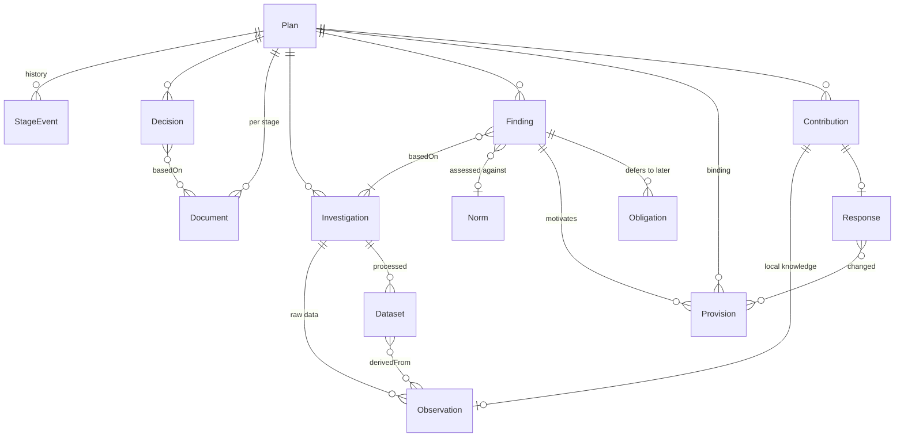

# Planning data specification

[`planning-data.yaml`](planning-data.yaml) defines the data the platform stores about a detaljplan as it moves from planbesked to genomförande. That includes the decisions and documents, the investigations and the evidence behind them, the binding provisions and their motives, the obligations passed to later stages, and citizens' contributions.

It is the source of truth for the backend model, the API and the entry forms. The rationale is in [docs/design/05-planning-evidence.md](../docs/design/05-planning-evidence.md).

**Scope for now:** what officials and citizens enter through the UI. Governance (ownership, retention, access control) is deliberately left out.

## Structure

| Section | Contents |
|---|---|
| `conventions`, `common_fields` | Rules every entity follows: uuid identity, append-only versions, provenance, EPSG:3006 + RH 2000 |
| `export` | How a plan is published to Lantmäteriet's national platform via the update API (mottagning → förändringar → upload → validation → publicering), and which versions go in as history |
| `stages` | The PBL 5 kap. process: what each stage produces, its LM status, legal minimum durations and duties (`facts`) |
| `enums` | Value lists. Where Lantmäteriet has one, we use its values (`lm:`) and mark our additions |
| `entities` | Plan, StageEvent, Decision, Document, Organisation, Investigation, Observation, Dataset, Norm, Finding, Provision, Obligation, Contribution, Response |
| `objects` | Embedded value objects (MeasuredValue, Threshold, Consequence, Viewpoint…) |

Every field can carry:
- `lm`: the path in Lantmäteriet's **Detaljplan 4.1** ([schema](https://namespace.lantmateriet.se/distribution/geodatakatalog/detaljplan/v4/detaljplan-4.1.json)), or `ext` when it's our extension. This is what makes export to the national geodata platform possible.
- `pbl`: the legal basis.
- `ui`: who enters it (`official`, `citizen`, `system`), the input widget, and from which stage.
- `required`: `true`, or the stage by which it must be set (e.g. `samrad`).
- `facts`: things that are easy to get wrong.

## The model at a glance



## Relation to Lantmäteriet Detaljplan 4.1

Lantmäteriet's specification covers the **adopted plan**: the plan, its decisions, provisions with motives, and a list of planning material by type. We map to it wherever it has a concept, and extend it for the work *before* adoption and for the evidence:

| We add | Because |
|---|---|
| `StageEvent`, statuses `forstudie`/`vilande` | LM keeps only the current status. Luleå's open data shows stale stages (Mjölkudden 3:13, Katten 6) |
| `Investigation` details (author, version, supersedes, summary) | LM `planeringsunderlag` is a document reference with a type |
| `Observation`, `Dataset`, `Norm`, `Finding` | The chain from raw data to provision exists only as PDF text today |
| `Obligation` | Deferred requirements (geotechnics, radon, soil) disappear at adoption |
| `Contribution`, `Response` | Participation (thesis framework, docs/design/00) |
| `Provision.motive` required | Optional in LM 4.1, but the law requires stored motives |
| Investigation types `skyfallsutredning`, `radonundersokning`, … | Used in Luleå's plans, not in LM's `underlagstyp`. Exported as `annat` |

## Validate

```sh
pip install -r scripts/requirements-data.txt
python scripts/validate_spec.py            # uses docs/inspo/lantmateriet/schema2.json
python scripts/validate_spec.py --lm-schema https://namespace.lantmateriet.se/distribution/geodatakatalog/detaljplan/v4/detaljplan-4.1.json
```

The validator checks
- internal consistency;
- that every `lm:` enum mapping exists in the Lantmäteriet schema;
- that every property Lantmäteriet *requires* on `detaljplan` and `planbestammelse` is filled by some field (otherwise no valid delivery is possible);
- that [`examples/katten-6.yaml`](examples/katten-6.yaml) (Katten 6 hand-entered from its planbeskrivning) matches the spec.

## Export to Lantmäteriet

[`scripts/export_lm.py`](../scripts/export_lm.py) turns a plan in our model into a Detaljplan 4.1 delivery and validates it against Lantmäteriet's schemas. See [examples/README.md](examples/README.md) for Katten 6: what maps, what is approximated, and what the national format can't carry.

## Creating plans in the platform

Officials create detaljplaner in the web app (Layers dock → *New detaljplan*). The editor builds the plan **as** a Detaljplan 4.1 delivery and checks it continuously against
- Lantmäteriet's JSON schema (`docs/inspo/lantmateriet/`, validated in the browser with ajv), and
- the delivery rules of Lantmäteriet's *Vägledning till nationell informationsspecifikation Detaljplan*, ch. 7. **Stops delivery:** DP-0002 coverage by användningsbestämmelser (10 cm tolerance), DP-0003 outside the plan, DP-0009 decimal without kind/unit, DP-0022 wording ≠ catalogue template, DP-Krav-0018 self-intersection, mandatory content at laga kraft (DP-0005/0012/0014/0017), BAS-006 empty text. **Warnings:** DP-Krav-0011 uses < 0.5 m apart, DP-Krav-0013 overlaps < 5 m².

How the guidance shapes the editor:
- Provisions are picked from Boverket's catalogue (`web/public/data/boverket/planbestammelsekatalog.json`, refreshed with `scripts/fetch_boverket_catalogue.py`). The wording is **generated** from the template and the entered variables, never typed.
- Drawing snaps to existing corners and edges, so shared borders coincide exactly (vägledning 3.2.5). "Use the whole plan area" copies the plan boundary's coordinates.
- Every polygon becomes its own `yta` with `lägesplacering / digital karta` and a positioning timestamp. Municipality is the name ("Luleå"), and implementation time is in months.
- Plans are saved as append-only versions (`/api/plans`, officials only; `påbörjad` plans are not public) and appear in the viewer like any other detaljplan. *Download for Lantmäteriet* gives the delivery file; it is disabled while anything stops delivery.

Code: `web/src/features/plan-editor/` (rules in `validate.ts`, tested in `validate.test.ts`), `code-with-quarkus/.../plans/`.

Not yet: holes in polygons, vertical bounds and 3D (`kropp`), line/point provisions, tillfälliga användningsbestämmelser (giltighetstid), the "allmän plats with enskilt huvudmannaskap" exception to DP-0002, and sending the delivery to Lantmäteriet's update API.

## Next steps

- Generate backend migrations and TypeScript types from this file rather than writing them by hand.
- Entry forms per entity, driven by the `ui` hints, starting with Investigation and Finding for officials and Contribution (kind `observation`) for citizens.
- A catalogue picker in the provision form, backed by Boverket's open API (`https://api.boverket.se/planbestammelsekatalogen/release/full/platt/aktuell`, 3 707 entries, 908 current).
